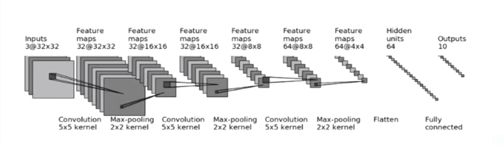

# 神经网络基础练习

本项目通过小例子学习感知机、前馈网络、卷积和池化。脚本主要用于观察计算过程与张量形状，不包含完整训练流程。

可复制的 [CNN 模板](#最简-cnn-模板)保留在本页，按顶部参数区填写结构图即可。

## 学习路线与代码

| 脚本 | 内容 | 建议观察 |
| --- | --- | --- |
| `neuron.py` | 单个 Sigmoid 感知机 | 加权和、偏置如何影响输出 |
| `muti_layer.py` | NumPy 多层前馈网络 | 每层权重矩阵的形状和数据传递 |
| `liner.py`、`nonliner.py` | 图片上的线性层与激活函数 | 最后一维变换、激活后的数值范围 |
| `conv1.py`、`conv2.py` | 一维与二维卷积 | 卷积核、步长、填充如何影响输出形状 |
| `pooling.py` | 最大池化与均值池化 | 空间尺寸缩小以及局部信息汇总 |
| `pic_process_(conv2test).py` | 图片卷积 | 图片 Tensor 形状和模型图记录 |
| `nn_module.py` | 按参数组装 CNN 并检查形状 | 可参考其完整实现；下方提供可复制的精简模板 |

## 核心概念

### 感知机与多层网络

`neuron.py` 手动计算 `Σ(xᵢwᵢ) + b`，再使用 Sigmoid 将结果映射到 0 到 1。可以先手算加权和，再和程序输出核对。

`muti_layer.py` 用 `model = [input_num] + hidden_num + [out_num]` 描述各层宽度，例如 `[3, 3, 2, 3, 1]`。每层权重形状为 `(本层宽度, 下一层宽度)`，前向计算为 `data @ weight + bias`，随后应用 Sigmoid。此例随机初始化权重，不进行训练；偏置是所有层共享的标量 0。

`liner.py` 对图片 Tensor 使用 `nn.Linear(1076, 720)`：Linear 只变换**最后一维**，因此它把每行的宽度从 1076 变成 720，不改变高度或通道数。换一张宽度不同的图片，`in_features=1076` 就不再匹配。`nonliner.py` 分别定义 ReLU、Tanh 和 Sigmoid，当前 `forward` 实际调用的是 Sigmoid；比较函数时要改调用处。原图经 `ToTensor()` 后像素通常已在 `[0,1]`，ReLU 对这些非负像素可能几乎没有可见效果。

`nonliner.py` 中“ReLU 一般用于二分类、Sigmoid 一般用于多分类”的注释不能当作固定规则：隐藏层常用 ReLU，二分类的单输出常用 Sigmoid，多分类通常使用多个类别分数并配合 Softmax 或相应损失函数。选择激活函数应结合它所在的层、任务与损失函数。

### 卷积

`conv1.py` 的输入形状为 `[batch, channel, length] = [1, 1, 5]`，卷积核为 `[out_channel, in_channel, kernel_length] = [1, 1, 3]`。`valid` 表示不补边；`padding=2` 表示左右各补两个零。

`conv2.py` 的输入形状 `[1, 1, 5, 5]` 表示 batch、输入通道、高和宽。二维卷积每个空间维度的输出大小为：

```text
out = floor((in + 2 × padding - kernel) / stride) + 1
```

PyTorch 的 `conv1d/conv2d` 实际执行互相关，核不会翻转；学习中通常仍统称卷积。

### 池化与图片卷积

`pooling.py` 将 `assets/zxw.jpg` 转为 `[C,H,W]` Tensor，再增加 batch 维得到 `[1,C,H,W]`。当前 forward 使用均值池化；将其替换为最大池化，可比较两者如何汇总局部区域。TensorBoard 日志写入 `.local-output/neural-network/log_network/`。

`pic_process_(conv2test).py` 使用 `nn.Conv2d(3, 3, kernel_size=2, stride=1, padding=1)` 处理图片，并把模型图写入 `.local-output/neural-network/log_conv/`。卷积核是随机初始化的，示例用途是观察数据流和形状，不代表有意义的图像增强。

卷积层用一组可学习的小卷积核在图像上滑动，对局部区域做加权计算，生成新的特征图。核的参数在不同位置共享，因此能用较少参数检测边缘、纹理等局部模式。`out_channels` 决定生成多少张特征图，`kernel_size` 决定每次观察的局部范围，`stride` 决定滑动步幅，`padding` 决定边缘补值及输出尺寸。

池化层不学习参数，而是对局部窗口做汇总。最大池化保留窗口内最大响应，均值池化计算窗口平均值。池化通常缩小特征图的宽高、减少后续计算，并让特征对小范围位置变化不那么敏感；代价是空间细节减少。卷积负责提取特征，池化负责压缩和汇总特征。

## 参数影响与常见问题

| 修改项 | 会改变什么 | 需要同步检查 |
| --- | --- | --- |
| `nn.Linear` 的 `in_features/out_features` | 输入最后一维要求和输出宽度 | 下一层输入宽度、图片实际宽度；尺寸不匹配会报矩阵乘法错误 |
| `Conv2d` 的通道数 | 特征图数量 | 第一层输入通道数；下一层 `in_channels` 是否等于上一层 `out_channels` |
| `kernel_size/stride/padding` | 感受野与输出高宽 | 输出尺寸是否为正；后续池化和 Flatten 尺寸是否仍匹配 |
| 池化的核与步长 | 输出高宽、保留的空间细节 | 连续池化可能把特征图缩到 0；`ceil_mode` 会改变边界取整 |
| 激活函数 | 输出范围与梯度传播 | ReLU 截断负响应；Sigmoid/Tanh 饱和时梯度变小；输出层选择须结合任务和损失 |
| 模板中的 `INPUT_*`、`output_size`、`POOLS` | 网络各层目标形状 | 图中尺寸须与卷积、池化顺序一致；对称整数 padding 未必能达到任意目标尺寸 |
| `HIDDEN_UNITS/OUTPUT_UNITS` | 分类器的隐藏宽度与最终输出宽度 | 改 `OUTPUT_UNITS` 时要与目标类别数或任务输出维度一致；此示例尚未接损失函数 |

二维卷积输出尺寸实际需要向下取整：`floor((输入 + 2×padding − 卷积核) / 步长) + 1`。下方模板按 `conv2.py` 的注释公式反算 padding，并要求结果是非负整数；它覆盖的是可用**对称整数 padding**精确实现的目标尺寸。

`pic_process_(conv2test).py` 顶部注释里的 padding 移项式漏了除以 2；按上下两侧都补相同宽度的约定，正确关系是 `padding = ((输出−1)×步长−输入+卷积核)/2`。当 stride 大于 1 时还要考虑输出尺寸公式中的向下取整。

## 最简 CNN 模板

下面的结构图对应一个常见 CNN：卷积和池化提取特征，Flatten 展平后接全连接层。



新建网络时复制下面整段代码，只修改最前面的“参数区”，其余部分保持不动。按图填写每层卷积的输出通道数、卷积核、步长和目标输出高宽，以及池化和全连接层参数；模板会自动计算 padding、卷积通道衔接和第一层 Linear 的输入宽度。

```python
import torch
from torch import nn


# ===== 只修改这里：把网络图上的参数填进来 =====
INPUT_CHANNELS = 3
INPUT_HEIGHT = 32
INPUT_WIDTH = 32

# 每层填写：输出通道、卷积核、步长、图中标注的输出 (高, 宽)
CONV_LAYERS = [
    {"out_channels": 32, "kernel": 5, "stride": 1, "output_size": (32, 32)},
    {"out_channels": 32, "kernel": 5, "stride": 1, "output_size": (16, 16)},
    {"out_channels": 64, "kernel": 5, "stride": 1, "output_size": (8, 8)},
]

# 卷积层编号: (池化核, 池化步长)；没有池化的层不写入
POOLS = {1: (2, 2), 2: (2, 2), 3: (2, 2)}
HIDDEN_UNITS = 64
OUTPUT_UNITS = 10
# ==============================================


def calc_padding(before, after, kernel, stride):
    # conv2.py: after = (before - kernel + 2*padding) / stride + 1
    numerator = (after - 1) * stride - before + kernel
    if numerator < 0 or numerator % 2:
        raise ValueError("该输入/输出尺寸无法用非负整数对称 padding 实现")
    return numerator // 2


class MyNetwork(nn.Module):
    def __init__(self):
        super().__init__()
        layers = []
        channels = INPUT_CHANNELS
        height, width = INPUT_HEIGHT, INPUT_WIDTH

        for i, config in enumerate(CONV_LAYERS, start=1):
            out_h, out_w = config["output_size"]
            pad_h = calc_padding(height, out_h, config["kernel"], config["stride"])
            pad_w = calc_padding(width, out_w, config["kernel"], config["stride"])
            layers.append(nn.Conv2d(
                channels, config["out_channels"], config["kernel"],
                config["stride"], padding=(pad_h, pad_w)
            ))
            channels = config["out_channels"]
            height, width = out_h, out_w

            if i in POOLS:
                pool_kernel, pool_stride = POOLS[i]
                layers.append(nn.MaxPool2d(pool_kernel, pool_stride))
                height = (height - pool_kernel) // pool_stride + 1
                width = (width - pool_kernel) // pool_stride + 1

        self.features = nn.Sequential(*layers)
        self.flatten = nn.Flatten()
        with torch.no_grad():
            sample = torch.zeros(1, INPUT_CHANNELS, INPUT_HEIGHT, INPUT_WIDTH)
            flattened_size = self.flatten(self.features(sample)).shape[1]
        self.classifier = nn.Sequential(
            nn.Linear(flattened_size, HIDDEN_UNITS),
            nn.Linear(HIDDEN_UNITS, OUTPUT_UNITS),
        )

    def forward(self, x):
        x = self.features(x)
        x = self.flatten(x)
        return self.classifier(x)
```

图上写的 `32@16×16` 对应一层卷积参数里的 `out_channels=32` 和 `output_size=(16, 16)`。`POOLS` 的键是卷积层编号；例如删掉键 `2` 表示第二层卷积后不做池化。padding 按 `conv2.py` 公式反算，Flatten 后的特征数也会自动推算，不需要手算或添加调试输出。

## 图片路径示例

不要直接写 `"assets/zxw.jpg"`：它是相对于终端当前目录的路径，启动位置变化时可能找不到文件。图片随脚本保存时，用 `Path(__file__)` 定位脚本目录：

```python
from pathlib import Path
from PIL import Image
import torchvision
from IPython.display import display

# __file__ 是当前 .py 文件的路径；parent 是它所在目录。
script_dir = Path(__file__).resolve().parent
image_path = script_dir / "assets" / "zxw.jpg"

# 打开图片并统一成 RGB 三通道。
with Image.open(image_path) as img:
    img = img.convert("RGB")

# 转成 PyTorch Tensor，形状为 [通道数, 高, 宽]，像素值在 [0, 1]。
to_tensor = torchvision.transforms.ToTensor()
img_tensor = to_tensor(img)
print(img_tensor.shape)

# %% 需要单独运行或预览时，只把这一段放在新的单元格中
display(img)
```

`Path` 的 `/` 运算符负责跨平台拼接路径。脚本旁边的素材适合用 `Path(__file__)`；仓库共享或需要环境变量配置的目录适合使用 `learning/common/paths.py` 中的常量：

```python
from learning.common.paths import SPEECH_AUDIO_DIR, REPO_ROOT

audio_path = SPEECH_AUDIO_DIR / "bird.wav"
image_path = REPO_ROOT / "learning" / "neural-network" / "assets" / "zxw.jpg"
```

## 在 VS Code 中单独调试代码块

在 `.py` 文件里，只需在**需要单独执行或预览的代码段前**写 `# %%`。VS Code 会将它识别为一个单元格。把光标放在该段中按 `Shift+Enter`，或点击上方的 **运行单元格**，即可单独运行这一段。其余连续的导入、路径设置、读图和预处理代码可以保留在同一个代码块中，无须全部拆开。

单独运行示例里的 `display(img)` 前，先运行读图代码，让 `img` 存在于当前 Python Interactive Window 会话中。若要从头重跑，按顺序执行前面的单元格，再执行预览单元格。

使用步骤：

1. 在 VS Code 安装并启用 **Python** 和 **Jupyter** 扩展。
2. 打开 `.py` 文件，选择包含项目依赖和 IPython 的 Python 解释器。
3. 运行需要的单元格；输出和图片会显示在 Python Interactive Window 中。

若提示找不到 `IPython`，在所选环境中安装：

```bash
python -m pip install ipython
```

普通终端运行 `.py` 文件不会提供 Notebook 式的内嵌输出区。

## 运行与依赖

损失函数、手动求梯度与 Autograd 的训练练习记录在 [`learning/network_training/README.md`](../network_training/README.md)。

从仓库根目录激活已经配置好的环境后，可直接运行脚本：

```bash
conda activate <你的环境名>
python learning/neural-network/conv2.py
python learning/neural-network/pooling.py
```

若希望运行前同步本项目依赖清单，使用统一入口：

```bash
python requirements/sync_requirements.py learning/neural-network/pooling.py
```

依赖清单为 `requirements/neural-network.txt`。新环境首次使用时安装：

```bash
python -m pip install -r requirements/neural-network.txt
```

PyTorch 用于张量和神经网络运算，TorchVision 用于图像变换，Pillow 用于读写图片，NumPy 用于多层网络示例，TensorBoard 用于记录模型图。图片练习使用 `assets/zxw.jpg`；运行会显示图片窗口的脚本需要可用的图形界面。

## 复习检查

从 `[N,C,H,W]` 能否推导卷积与池化后的形状？为什么 `liner.py` 只改变最后一维？`nonliner.py` 当前真正使用哪个激活函数？`nn_module.py` 哪些参数来自结构图，哪些由程序自动推算？
